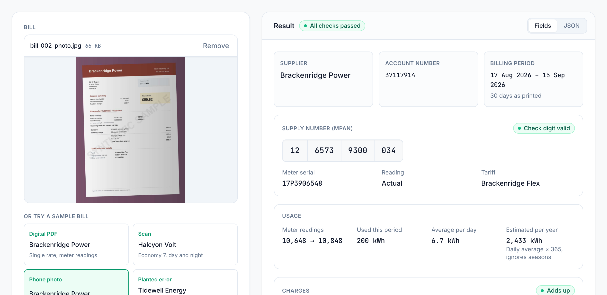
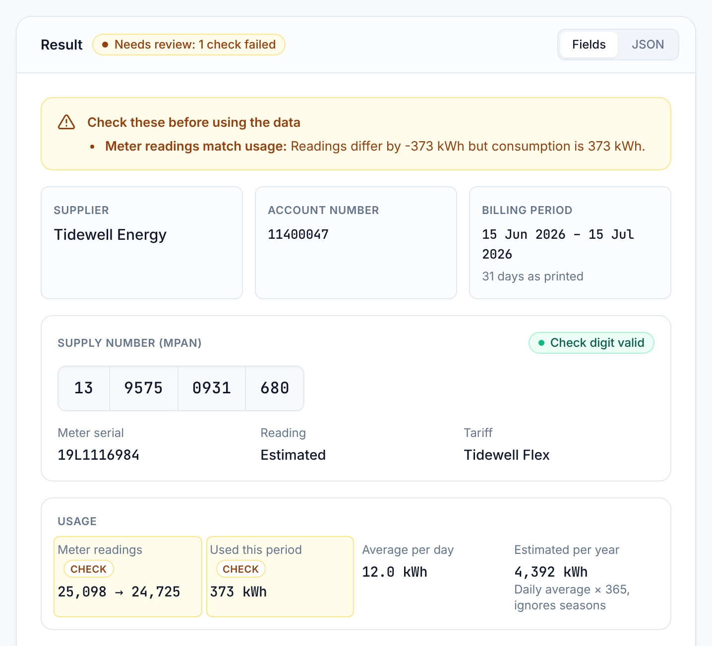
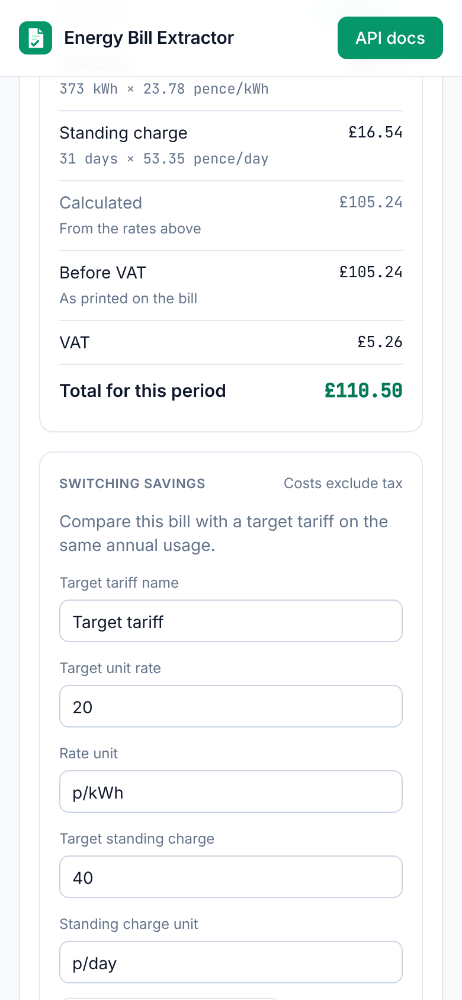
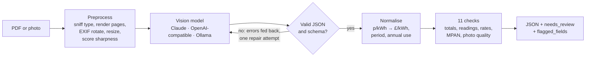

# Energy Bill Extractor

[](https://github.com/SujahathMSM/energy-bill-extractor/actions/workflows/ci.yml)

**Upload an electricity bill (PDF or phone photo) and get validated JSON back: a vision model
reads the bill, then plain code checks that every number adds up and flags the bills a
person should look at.**



## In 30 seconds

- **Problem.** Switching energy supplier means copying a supply number, tariff, unit rates,
  standing charge and usage off an old bill. A model can read the bill, but one misread
  digit quietly mis-prices a customer.
- **Approach.** The model only *reads*: it copies values as printed. Code does the
  arithmetic: unit conversion, reconciling charges, meter readings and totals, and the MPAN
  check digit. Any failed check sets `needs_review` and names the fields to look at.
- **Measured.** On a synthetic set of 24 bills read as PDF, scan and phone photos at four
  levels of damage, Claude Sonnet 5.5 scored **97.5% field accuracy** (99.6–99.8% up to
  moderate damage). The checks caught **36 of 36 bills with a planted error**. Each bill
  takes about 2.6 s and $0.013; Haiku 5.5 costs about $0.0008. See [EVALS.md](EVALS.md).
- **Engineered.** Strict Pydantic schema with a repair attempt, retries with backoff,
  input guards, no bill contents in logs, 200+ tests with no network, Docker, CI, and a
  one-command eval.

| | |
|---|---|
|  |  |
| A planted error (swapped meter readings) is flagged and the fields are highlighted. | Mobile layout. |

## Results

From [EVALS.md](EVALS.md): recorded runs of 17 October 2026 on synthetic bills. Real bills are
personal data, so none are used.

| Model | Documents | Field accuracy | Every field right | Planted errors caught | p50 / p95 latency | Cost per bill |
|---|---|---|---|---|---|---|
| Sonnet 5.5, clean PDF / scan / photo | 30 | **100%** | 100% | – | 2.5 s / 3.2 s | ~$0.011 |
| Sonnet 5.5, photos clean → severe | 96 | **97.5%** | 78.1% | – | 2.6 s / 7.0 s | ~$0.013 |
| Haiku 5.5, photos clean → severe | 96 | 96.0% | 68.8% | – | 4.0 s / 7.9 s | ~$0.0008 |
| Haiku 5.5, 12 of 24 bills with a planted error | 72 | 99.6% | 91.7% | **36 / 36** | 3.4 s / 4.6 s | ~$0.0008 |
| Qwen2.5-VL 3B, local GPU | 10 | 88.4% | 0% | – | 26.4 s / 43.4 s | $0 |

What failed, and what was done about it:

- **Accuracy falls only on severely damaged photos.** Sonnet scores 99.6% up to moderate
  damage and 91% on severe. A photo-quality check now flags blurry and low-resolution
  photos for review.
- **Long digit strings fail first.** The MPAN and meter serial are the weakest fields. The
  MPAN check digit catches most of these misreads.
- **What the checks miss.** They catch numbers that don't add up, not a misread name or an
  omitted optional field: 67% of the models' own errors were flagged, with 0% false alarms.

The harness re-runs with one command (`make eval`). This branch was finished without an API
key, so its latest run is a clearly labelled simulated self-test; the numbers above are the
recorded real runs.

## How it works



1. **Preprocess** (`preprocess.py`). The file type comes from its bytes, not the client's
   `Content-Type`. PDFs are rendered page by page (first 3; skipped pages are reported in
   `warnings`). Photos are turned upright from EXIF, resized, and scored for sharpness.
   Rejected with clear 4xx errors: password-protected or damaged PDFs, decompression bombs,
   non-bill files.
2. **Read** (`backends/`). The model copies each field exactly as printed (`24.86`, `"p/kWh"`),
   or null if it isn't printed. The provider is chosen with one environment variable. SDK
   retries cover connection errors, 429 and 5xx, with exponential backoff.
3. **Validate** (`schema.py`, `extractor.py`). A strict Pydantic schema: ISO currency codes,
   real dates, no negative rates or kWh, no `NaN`. If the reply isn't JSON or doesn't fit
   the schema, the errors go back to the model for one repair attempt. After that the API
   returns 422, not a guess.
4. **Check** (`validation.py`). Each check returns pass, fail or skipped, with a reason and
   the fields it read:

   | Check | Catches |
   |---|---|
   | `cost_reconciles` | rates × kWh + standing charge ≠ subtotal: a misread rate, or pence read as pounds |
   | `total_reconciles` | subtotal + tax + other charge lines ≠ total |
   | `readings_match_consumption` | current − previous reading ≠ kWh used |
   | `bands_match_consumption` | day + night kWh ≠ total kWh |
   | `rates_plausible` | a unit rate outside a sane range for the currency |
   | `meter_point_checksum` | the GB MPAN check digit fails: a digit was misread |
   | `currency_consistent`, `units_understood` | units that imply another currency, or can't be parsed |
   | `billing_period` | end before start, implausible length, or a printed day count that disagrees with the dates |
   | `onboarding_fields` | something needed to set up the customer is missing |
   | `input_quality` | the photo is too blurry or too small to trust |

5. **Respond.** The response holds the fields as printed, the derived figures, every check,
   `needs_review`, `review_reasons` and `flagged_fields`. One log line per request records
   the ID, latency and failed check names, never the bill's contents.

`POST /v1/savings` then compares the bill with a target tariff on the same annual usage, the
pitch to the customer once onboarding is done (`savings.py`).

## Design decisions and trade-offs

- **The model reads; code calculates.** Models are good at transcription and unreliable at
  arithmetic. Keeping the arithmetic in code makes it testable and the failures explainable.
- **Checks instead of confidence scores.** A model's confidence in a digit is not
  calibrated; whether a sum adds up is a fact. Input quality is the one "confidence" signal
  used, because it is measurable, and its threshold was calibrated against accuracy.
- **Null over a guess.** The prompt and schema make "not printed" an explicit answer, and the
  eval counts invented values separately from missed ones.
- **JSON in the prompt by default.** Claude's structured output rejected this schema as too
  complex, and Sonnet 5.5 refuses forced tool calls. Both modes remain opt-in, with
  automatic fallback. Prompt mode plus validation and repair gave 100% schema-valid replies
  on the real runs.
- **What is printed wins.** Suppliers count billing days differently, so a printed day count
  overrides one counted from the dates.
- **Sonnet by default, Haiku as the cheap option.** Sonnet is more accurate on poor photos
  and long digit strings; Haiku is about 16× cheaper and caught every planted error. Switch
  with `BILLX_ANTHROPIC_MODEL`.
- **Nothing is stored.** Files are processed in memory, logs exclude bill contents, and
  CORS is off unless configured.

The full list of judgement calls is in [DECISIONS.md](DECISIONS.md).

## Quickstart

**Docker** (API and UI on http://localhost:8000; demo mode with no key):

```bash
docker compose up --build
```

**Local** (Python 3.11+):

```bash
python -m venv .venv && source .venv/bin/activate
make install
make dev
```

The **demo mode** (`BILLX_BACKEND=mock`) needs no API key. The four sample bills on the page
return their known values, one of them with a planted error, so the review flow shows
immediately; any other file returns one fixed example bill. To read real bills, copy
`.env.example` to `.env` and set:

| Model | Settings |
|---|---|
| Claude | `BILLX_BACKEND=anthropic`, `ANTHROPIC_API_KEY=...` (optional: `BILLX_ANTHROPIC_MODEL=claude-haiku-5-5`) |
| Local, with Ollama | `ollama pull qwen2.5vl:3b`, then `BILLX_BACKEND=ollama` (or `docker compose --profile local up`) |
| OpenAI or vLLM | `BILLX_BACKEND=openai`, `BILLX_OPENAI_MODEL=...`, and `OPENAI_API_KEY` or `OPENAI_BASE_URL` |

Every setting is documented in [.env.example](.env.example). `make help` lists all targets.
Deploying to Render takes a few clicks; see [DEPLOY.md](DEPLOY.md).

## API

```bash
curl -F "file=@bill_extractor/static/samples/bill_011_fault.pdf" http://localhost:8000/v1/bills/extract
```

The response (trimmed), from the planted-error sample in demo mode:

```json
{
  "extraction": {
    "supplier_name": "Tidewell Energy",
    "meter_point_id": "1395750931680",
    "billing_period_start": "2026-06-15",
    "billing_period_end": "2026-07-15",
    "previous_reading": 25098.0,
    "current_reading": 24725.0,
    "consumption_kwh": 373.0,
    "unit_rates": [{"label": "Standard", "rate": 23.78, "rate_unit": "pence/kWh", "kwh": 373.0}],
    "standing_charge": 53.35,
    "standing_charge_unit": "pence/day",
    "total_amount": 110.5
  },
  "derived": {
    "currency": "GBP", "period_days": 31,
    "unit_rates": [{"label": "Standard", "per_kwh": 0.2378, "kwh": 373.0}],
    "standing_charge_per_day": 0.5335, "estimated_annual_kwh": 4392.0
  },
  "checks": [
    {"name": "readings_match_consumption", "status": "fail",
     "detail": "Readings differ by -373 kWh but consumption is 373 kWh.",
     "fields": ["previous_reading", "current_reading", "consumption_kwh"]},
    {"name": "cost_reconciles", "status": "pass",
     "detail": "Rates x kWh + standing charge = 105.24, subtotal 105.24.", "fields": ["..."]},
    {"name": "meter_point_checksum", "status": "pass", "detail": "MPAN check digit is valid.",
     "fields": ["meter_point_id"]}
  ],
  "needs_review": true,
  "review_reasons": ["readings_match_consumption: Readings differ by -373 kWh but consumption is 373 kWh."],
  "flagged_fields": ["previous_reading", "current_reading", "consumption_kwh"],
  "warnings": [],
  "meta": {"request_id": "7f27bff8f314", "backend": "mock", "model": "mock-demo",
           "attempts": 1, "latency_ms": 153, "pages_sent": 1, "pages_in_file": 1}
}
```

| Status | Meaning |
|---|---|
| 400 | Empty file |
| 413 | File over `BILLX_MAX_UPLOAD_MB`, or an image with too many pixels |
| 415 | Not a readable PDF, PNG, JPEG, WebP or HEIC (e.g. password-protected PDF) |
| 422 | The model's answer never matched the schema, even after the repair attempt |
| 502 / 503 / 504 | Provider error / busy or rate-limited (`Retry-After` set) / timed out |

Each error has a readable `detail` and an `X-Request-ID` header. Interactive docs are at
`/docs`. `POST /v1/savings` takes an extraction and a target tariff and returns the annual
saving (example in `/docs`).

## Tests, lint and evaluation

```bash
make test         # 200+ tests: schema, checks, file handling, API, retries, repair path; no network
make lint         # ruff check + ruff format --check
make eval         # Claude if ANTHROPIC_API_KEY is set, else a labelled simulated run
make eval-oracle  # harness self-test: the ground-truth backend must score 100%
```

The provider SDKs are exercised with a fake HTTP transport, so tests check the exact request
bodies sent to Claude and OpenAI-compatible servers, and every fallback and retry path. CI
runs lint and tests on every push and PR, then builds the Docker image and smoke-tests it.

## Project layout

```
bill_extractor/
  api.py            FastAPI app: endpoints, error mapping, CORS, upload guard
  extractor.py      pipeline: preprocess, model call, validate and repair, checks
  preprocess.py     PDF/image/HEIC to page images; size, blur and type guards
  schema.py         strict Pydantic models (also the JSON schema sent to the model)
  prompts.py        system prompt and instructions
  validation.py     unit normalisation, derived figures, the checks
  savings.py        switching-savings estimate
  backends/         anthropic, openai-compatible (OpenAI, Ollama, vLLM), mock
  synth.py          synthetic bill generator (layouts, faults, photo damage)
  scoring.py        field-level scoring and summary metrics
  pricing.py        token prices for cost estimates
  static/           demo page and sample bills
evals/              generate_dataset.py, run_eval.py, simulated.py, results/
tests/              pytest suite
```

## Limitations and next steps

- **Synthetic data only.** 3 layouts and 5 fictional suppliers are cleaner than real bills.
  The next step is a small set of real bills, used with consent and redacted, to measure
  real-world accuracy and to re-calibrate the blur threshold.
- **UK electricity only.** Gas, dual fuel, multi-register readings and export tariffs are
  not modelled.
- **Some errors are invisible to arithmetic.** A misread supplier name, a meter serial, or
  an MPAN misread that still passes its check digit. Per-field source locations would let a
  reviewer jump to each value on the bill.
- **Annual use ignores seasons.** It is the daily average × 365.
- **No auth or rate limiting.** Put the API behind a gateway before exposing a real-model
  backend publicly.

Also in this repository: [AUDIT.md](AUDIT.md) (the state of the project before the final
polish) and [DECISIONS.md](DECISIONS.md).

## License

MIT
