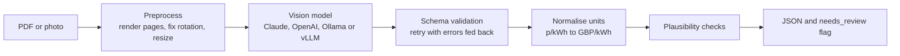

# Energy Bill Extractor

Upload an electricity bill, as a PDF or a phone photo, and get the tariff and usage back as
validated JSON. A vision-language model reads the bill. Plain code then checks that the numbers
add up, and flags any bill a person should look at before the data is used.

## Why

Switching energy supplier means copying details off an old bill: supply number, tariff, unit
rates, standing charge and usage. Reading the bill automatically makes onboarding much faster.
But a model that misreads one digit of a unit rate quietly mis-prices a customer, so the
extraction cannot be trusted on its own. This project uses the model as the reader and code as
the checker.

## How it works



### Design decisions

- **The model reads, code calculates.** The model copies values as printed (`24.86`, `"p/kWh"`).
  Unit conversion, period length and the annual-use estimate happen in Python. Models are good
  at reading and unreliable at arithmetic.
- **Null rather than a guess.** The prompt and schema make "not printed on the bill" an explicit
  answer, and the evaluation counts invented values separately from missed ones.
- **JSON from Claude that works with any model.** By default the schema goes into the prompt
  and the reply is parsed and validated. Two stricter modes are opt-in, because tests against
  claude-sonnet-5-5 ruled them out as defaults:
  - Structured output (`output_config.format`) failed with "Schema is too complex", after
    about two minutes spent compiling it. Making missing fields optional rather than nullable
    first got it under the documented limit of 16 union-typed parameters, but not under the
    model's internal compile limit.
  - A forced tool call was rejected: this model does not accept `tool_choice` of type `tool`.

  Prompt mode extracted every field correctly with no retries on the test bills. If a chosen
  mode is rejected, the backend falls back to the next one and remembers what worked.
  OpenAI-compatible servers get a JSON-schema response format, with a fallback to plain JSON
  mode.
- **Validate, then retry once.** If the reply does not match the schema, the validation errors
  are sent back to the model for one more attempt.
- **Checks instead of confidence scores.** A model's confidence in a number is not calibrated;
  arithmetic is. Every check reports pass, fail or skipped, with a reason:

  | Check | What it catches |
  |---|---|
  | `cost_reconciles` | Rates x kWh + standing charge differs from the subtotal: a misread rate or kWh, or pence read as pounds |
  | `total_reconciles` | Subtotal + VAT differs from the total |
  | `readings_match_consumption` | Current reading - previous reading differs from kWh used |
  | `bands_match_consumption` | Day + night kWh differs from total kWh |
  | `rates_plausible` | A unit rate outside a sane range for the currency |
  | `meter_point_checksum` | The GB MPAN check digit fails: a digit was misread |
  | `currency_consistent` | The units imply a different currency from the one stated |
  | `billing_period` | The period ends before it starts, or is implausibly long |
  | `onboarding_fields` | Something needed to set up the customer is missing |

- **Nothing is stored.** Bills are personal data. Files are processed in memory, and each
  request logs one line with its ID, latency and failed checks, never the bill's contents.
- **Any model provider.** The backend is chosen with one environment variable, and the same
  tests cover each one.

## Quick start

```bash
python -m venv .venv && source .venv/bin/activate
pip install -e ".[dev]"
make run        # http://localhost:8000, using the mock backend (no API key needed)
```

Open http://localhost:8000, drop in a file from `samples/`, and you get the extracted fields
and every check. API docs are at http://localhost:8000/docs.

To use a real model, copy `.env.example` to `.env` and set one of:

| Model | Settings |
|---|---|
| Claude | `BILLX_BACKEND=anthropic`, `ANTHROPIC_API_KEY=...` |
| Local, with Ollama | `ollama pull qwen2.5vl:3b`, then `BILLX_BACKEND=ollama`. Pick a model size that fits your GPU. |
| OpenAI or vLLM | `BILLX_BACKEND=openai`, `BILLX_OPENAI_MODEL=...`, and `OPENAI_API_KEY` or `OPENAI_BASE_URL` |

With Docker: `docker compose up --build`, or `docker compose --profile local up --build` to run
Ollama alongside it.

## API

```bash
curl -F "file=@samples/bill_002_photo.jpg" http://localhost:8000/v1/bills/extract
```

This is the response from the mock backend, which always returns the same fixed bill. A real
model returns the fields from your file.

```json
{
  "extraction": {
    "supplier_name": "Fernwick Energy",
    "meter_point_id": "1600123456785",
    "tariff_name": "Fernwick Fixed Nov 2027",
    "billing_period_start": "2026-08-14",
    "billing_period_end": "2026-09-12",
    "consumption_kwh": 287.0,
    "unit_rates": [{"label": "Standard", "rate": 24.86, "rate_unit": "p/kWh", "kwh": 287.0}],
    "standing_charge": 51.42,
    "standing_charge_unit": "p/day",
    "total_amount": 91.12
  },
  "derived": {
    "currency": "GBP",
    "period_days": 30,
    "unit_rates": [{"label": "Standard", "per_kwh": 0.2486, "kwh": 287.0}],
    "standing_charge_per_day": 0.5142,
    "estimated_annual_kwh": 3492.0
  },
  "checks": [
    {"name": "cost_reconciles", "status": "pass", "detail": "Rates x kWh + standing charge = 86.77, subtotal 86.78."},
    {"name": "meter_point_checksum", "status": "pass", "detail": "MPAN check digit is valid."}
  ],
  "needs_review": false,
  "review_reasons": [],
  "meta": {"backend": "mock", "model": "mock-fixed-bill", "attempts": 1, "latency_ms": 28, "pages_sent": 1}
}
```

The response is trimmed here. Errors use standard codes: 413 (file too large), 415 (not a PDF
or image), 422 (the model's answer never matched the schema) and 502 (provider error).

## Evaluation

`bill_extractor.synth` generates labelled UK bills in three layouts, each rendered as a digital
PDF, a 150 dpi scan and a phone-style photo (tilted, blurred, unevenly lit):

- **Single rate**, with previous and current meter readings, actual or estimated.
- **Economy 7**, with day and night rates from a smart meter and no cumulative readings. The
  model should return null for the readings, not invent them.
- **Account summary first**, with a previous balance, so the large "Amount due" figure is not
  this period's charges. It tests whether the model picks the right total.

Dates, unit spellings and decimal places vary between bills. Suppliers, names and addresses are
fictional, and every page is watermarked as a synthetic sample.

```bash
make data                                                # 24 bills x 3 formats
python -m bill_extractor.evaluate --backend anthropic --limit 10
```

The report (Markdown and JSON in `reports/`) gives:

- Field accuracy, overall and per field, split into correct, wrong, missed and invented values.
- Share of documents with every field correct, by input type (PDF, scan, photo).
- **Review-flag quality:** of the documents the model got wrong, how many the checks flagged
  (catch rate), and how many fully correct documents were flagged anyway (false-alarm rate).
- Latency (p50 and p95), mean attempts and token use.

### Results

claude-sonnet-5-5 in prompt mode, run on 17 October 2026: 10 bills in 3 formats, so 30
documents and 510 fields.

| Input | Documents | Field accuracy | All fields correct |
|---|---|---|---|
| Digital PDF | 10 | 100% | 100% |
| 150 dpi scan | 10 | 100% | 100% |
| Phone-style photo | 10 | 100% | 100% |

- No wrong, missed or invented values. Every reply passed schema validation on the first
  attempt.
- Latency per bill: 2.5 s median, 3.2 s p95.
- About 4,200 input and 270 output tokens per bill.

**What this does and does not show.** The synthetic bills are clean and consistently laid out,
so a perfect score shows the pipeline works end to end, not that it will be perfect on real
bills. With no errors in the run, it also could not measure how often the review flag catches
real mistakes. The unit tests cover the flag by feeding in known errors: pence read as pounds,
a misread MPAN digit, and totals that do not add up. The next step is a harder set: real bills
used with consent, more layouts, and worse photos.

## Tests

`make test` runs 78 tests without network access or API keys. They cover:

- Preprocessing.
- Every check, including that the generator's ground truth passes all of them.
- The retry loop.
- The evaluation harness: a backend that returns the ground truth must score 100%.
- The exact request bodies sent to Claude and to OpenAI-compatible servers, and each fallback
  path, using the real SDKs with a fake HTTP transport.

CI runs lint and the tests, then builds the Docker image and smoke-tests it.

## Project layout

```
bill_extractor/
  api.py            FastAPI app and demo page
  extractor.py      pipeline: preprocess, model call, validate and retry, checks
  preprocess.py     PDF and image to page images
  prompts.py        system prompt and instructions
  schema.py         Pydantic models (also the JSON schema sent to the model)
  validation.py     unit normalisation, derived figures, plausibility checks
  backends/         anthropic, openai-compatible (OpenAI, Ollama, vLLM), mock
  synth.py          synthetic bill generator
  scoring.py        field-level scoring and summary metrics
  evaluate.py       evaluation CLI
  static/index.html demo page
samples/            three synthetic bills in each format
tests/
```

## Limitations and next steps

- Synthetic bills are cleaner than real ones. Measuring real-world accuracy needs a labelled set
  of real bills, used with consent and redacted.
- Only UK electricity is modelled. Gas, dual fuel, multi-register readings and export tariffs are
  not yet supported.
- The annual-use estimate is average daily use x 365, so it is skewed by the season the bill
  covers.
- Possible next steps: source locations for each field so a reviewer can jump to it, a
  cost and latency comparison across models, and turning reviewed corrections into new
  evaluation cases.

## License

MIT
